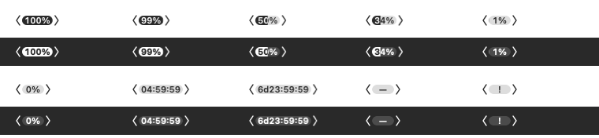
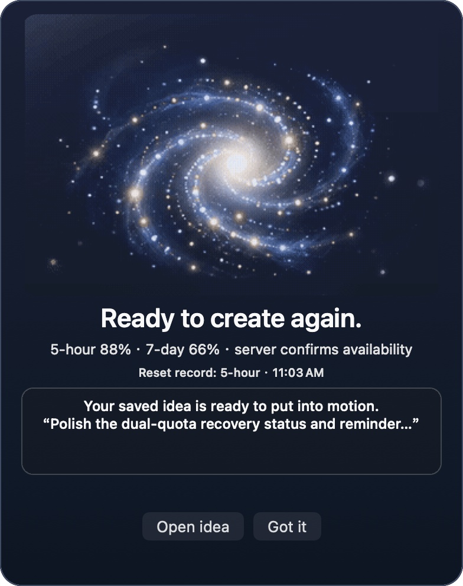

# Codex Usage Bar

**A little signal from the cosmos: see your Codex plan usage, save the thought you don't want to lose, and know when both limits are ready again.**

Codex Usage Bar is a small, open-source macOS menu-bar companion. Its live indicator keeps the useful number close at hand; when a quota runs dry, a quiet countdown and an idea pad turn waiting time into thinking time. When a reset is confirmed and both standard windows are available, a starfield celebration marks the return.

> An independent community project. Not affiliated with, endorsed by, or an official product of OpenAI.

## A glimpse

The showcase images use synthetic preview data; they do not show a live Codex account.

The menu-bar signal is compact by design: a small fill shows the selected remaining percentage without borrowing the system battery's silhouette.



When a reset is confirmed, a midnight-blue starfield brings a little ceremony to the moment. The reminder stays open until dismissed, respects Reduce Motion, and never claims you can resume work unless **both** the 5-hour and 7-day windows are available and the Codex server allows it.

English:



简体中文：


## What it does

- **At-a-glance usage.** A proportional fill sits behind the remaining percentage in the menu-bar indicator. When a known quota is exhausted, the number becomes a live countdown to the later reset time.
- **Both windows, clearly.** Inspect the 5-hour and 7-day limits separately. A single reset is reported as partial; the app says work can resume only after a fresh response confirms both standard windows are below 100%, the account permits ordinary usage, and no server restriction is active.
- **A place for the almost-lost thought.** Capture a draft while waiting, then browse, edit, copy, and organize saved ideas locally. The app never sends an idea to Codex or executes it.
- **A spark of perspective.** Each open offers one of 99 sourced thinking quotes. Choose Chinese or English manually; each view shows one language at a time.
- **A small cosmic celebration.** A confirmed full reset can open a starfield reminder with a gentle optional chime. The notice stays until you dismiss it. Partial resets remain calm and precise.
- **Your choice at login.** Turn automatic startup on or off from the menu-bar panel; macOS approval status is shown when needed.
- **Local by design.** Usage is read from the Codex CLI app-server. Drafts and reset metadata stay on this Mac; prompts, conversations, and credentials are not read or uploaded.

## Install and build

### Requirements

- macOS 13 or later (the app targets macOS 13; only Intel macOS 26 has been runtime-tested in this checkout)
- Swift 5.9 or later and the macOS SDK
- A signed-in Codex CLI account with plan rate limits available. API-key-only usage does not provide these plan limits.

Build a universal app for Apple silicon and Intel:

```sh
./build.sh
open "dist/Codex Usage.app"
```

The build is ad-hoc signed and **not Developer ID signed or notarized**. For now, building from source is the recommended way to try the app. A Codex CLI path found on the build machine is recorded as a convenience; on another Mac the app checks common CLI locations. The CLI manages its own authentication.

Use **Launch at login** in the menu-bar panel to opt in or out. When macOS requires approval, the app offers a shortcut to System Settings → General → Login Items.

To build only the Swift executable:

```sh
swift build -c release --product CodexUsage
```

Create a portable, ad-hoc-signed universal ZIP without embedding the builder's local Codex CLI path:

```sh
./scripts/package_unsigned_release.sh
```

This package is not Developer ID signed or notarized; see the release notes before installing it.

## Try the flow safely

Run a synthetic rehearsal without using your live quota or idea library:

```sh
open "dist/Codex Usage.app" --args --demo
```

The demo cycles through synthetic quota states, marks the status icon with `D`, labels its panels **DEMO DATA**, and writes its event log and temporary data path to the launching terminal. It never starts Codex app-server or uses the real idea/reset stores. Quit the demo before removing its temporary directory.

Run the checks:

```sh
./scripts/verify.sh
```

The suite covers deterministic quota/reset logic and local idea storage, validates all 99 quote entries, and measures native layouts for both language variants. Static previews and synthetic flows do not replace testing on every supported macOS release or observing a real reset while online.

## Privacy and limits

Codex Usage Bar starts the installed Codex CLI in app-server mode and calls only `account/rateLimits/read`. It does not create a conversation, submit a prompt, make a model request, or execute a saved idea. Authentication remains in the CLI.

Drafts and ideas are stored as plain JSON under `~/Library/Application Support/local.codex.usage-bar/ideas.json`. The app restricts file permissions, but the contents are **not encrypted**. Neither ideas nor quota snapshots are uploaded by this app. A reset reminder is possible only while the app is open and online; the first valid snapshot after launch establishes a baseline, so a reset that happened before launch will not be invented as a new event.

See [SECURITY.md](SECURITY.md) for reporting guidance, [CONTRIBUTING.md](CONTRIBUTING.md) for development notes, and [CODEX_USAGE_QUOTES.md](CODEX_USAGE_QUOTES.md) for quote sources, locators, translation credits, and verification notes.

## License

The project source is released under the [MIT License](LICENSE). Bundled artwork and the reset chime are separate media assets, released under [Creative Commons Attribution 4.0](https://creativecommons.org/licenses/by/4.0/) with provenance in [ASSET_LICENSES.md](ASSET_LICENSES.md); the media license does not cover third-party reference material or trademarks.
